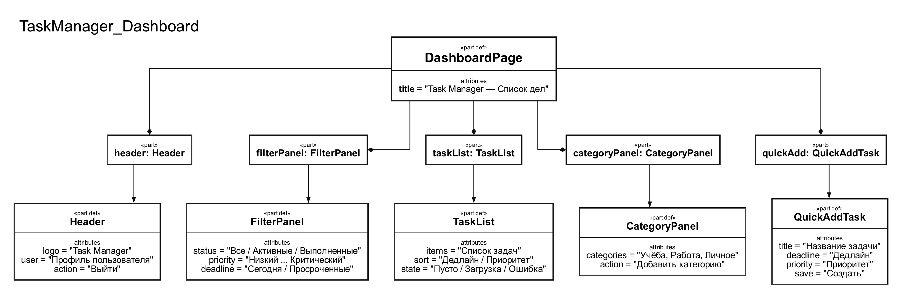
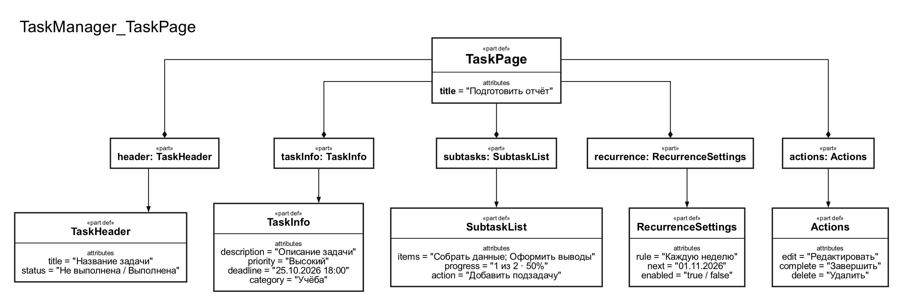

# Спецификация требований к ПО

Для веб-приложения списка дел «Task Manager»

Версия 0.1

Подготовила: Климова Авелина Алексеевна

БГУИР

25.10.2026

## Оглавление

* [1. Введение](#1-introduction)
  * [1.1 Назначение документа](#11-document-purpose)
  * [1.2 Область применения продукта](#12-product-scope)
  * [1.3 Определения, акронимы и сокращения](#13-definitions-acronyms-and-abbreviations)
  * [1.4 Ссылки](#14-references)
  * [1.5 Обзор документа](#15-document-overview)
* [2. Обзор продукта](#2-product-overview)
  * [2.1 Перспектива продукта](#21-product-perspective)
  * [2.2 Функции продукта](#22-product-functions)
  * [2.3 Ограничения продукта](#23-product-constraints)
  * [2.4 Характеристики пользователей](#24-user-characteristics)
  * [2.5 Допущения и зависимости](#25-assumptions-and-dependencies)
  * [2.6 Распределение требований](#26-apportioning-of-requirements)
* [3. Требования](#3-requirements)
  * [3.1 Внешние интерфейсы](#31-external-interfaces)
    * [3.1.1 Пользовательские интерфейсы](#311-user-interfaces)
    * [3.1.2 Аппаратные интерфейсы](#312-hardware-interfaces)
    * [3.1.3 Программные интерфейсы](#313-software-interfaces)
  * [3.2 Функциональные требования](#32-functional)
  * [3.3 Качество обслуживания](#33-quality-of-service)
    * [3.3.1 Производительность](#331-performance)
    * [3.3.2 Безопасность](#332-security)
    * [3.3.3 Надёжность](#333-reliability)
    * [3.3.4 Доступность](#334-availability)
    * [3.3.5 Наблюдаемость](#335-observability)
  * [3.4 Соответствие стандартам](#34-compliance)
  * [3.5 Проектирование и реализация](#35-design-and-implementation)
    * [3.5.1 Установка](#351-installation)
    * [3.5.2 Сборка и поставка](#352-build-and-delivery)
    * [3.5.3 Распределение](#353-distribution)
    * [3.5.4 Сопровождаемость](#354-maintainability)
    * [3.5.5 Повторное использование](#355-reusability)
    * [3.5.6 Переносимость](#356-portability)
    * [3.5.7 Стоимость](#357-cost)
    * [3.5.8 Сроки](#358-deadline)
    * [3.5.9 Доказательство концепции](#359-proof-of-concept)
    * [3.5.10 Управление изменениями](#3510-change-management)
  * [3.6 ИИ/МО](#36-aiml)
* [4. Верификация](#4-verification)
* [5. Приложения](#5-appendixes)

## История изменений

| Автор | Дата | Причина изменения | Версия |
|---|---|---|---|
| Климова А.А. | 25.10.2026 | Создание первоначальной версии документа | 0.1 |

---

## 1. Введение {#1-introduction}

### 1.1 Назначение документа {#11-document-purpose}

Настоящий документ представляет собой спецификацию требований к веб-приложению списка дел «Task Manager». Документ фиксирует бизнес-цели, границы продукта, пользовательские сценарии и проверяемые требования к системе, описывая **что** должна делать система, а не конкретный способ реализации.

Спецификация предназначена для заказчика, разработчика, тестировщика и преподавателя. Она используется как основа для проектирования интерфейсов, планирования разработки, подготовки тестов и приёмки лабораторной работы.

### 1.2 Область применения продукта {#12-product-scope}

**«Task Manager»** — веб-приложение для ведения личного списка дел. Пользователь создаёт задачи, назначает им приоритеты и дедлайны, группирует задачи по категориям, разбивает крупные дела на подзадачи и задаёт правила повторения.

Продукт решает следующие бизнес-задачи:

* уменьшает риск забыть о важных делах и пропустить срок;
* помогает пользователю видеть текущую загрузку и порядок выполнения дел;
* позволяет одинаково организовать рабочие, учебные и личные задачи;
* сокращает время на повторное создание регулярно выполняемых задач.

**Входит в область применения:**

* создание, просмотр, редактирование, завершение и удаление задач;
* назначение приоритета, дедлайна и категории;
* создание и выполнение подзадач;
* настройка повторяющихся задач;
* поиск, фильтрация и сортировка задач;
* регистрация и вход пользователя для хранения личных данных.

**Не входит в область применения версии 0.1:**

* совместное редактирование задач несколькими пользователями;
* распределение задач между исполнителями;
* встроенный чат и видеоконференции;
* полноценный календарь с синхронизацией внешних календарей;
* автоматическая генерация задач средствами искусственного интеллекта;
* нативные приложения для iOS и Android.

### 1.3 Определения, акронимы и сокращения {#13-definitions-acronyms-and-abbreviations}

| Термин | Определение |
|---|---|
| API | Application Programming Interface — программный интерфейс взаимодействия компонентов. |
| Дедлайн | Дата и время, до которых задача должна быть выполнена. |
| Категория | Пользовательская группа задач, например «Учёба», «Работа» или «Личное». |
| Подзадача | Дочерняя задача, являющаяся частью более крупной задачи. |
| Приоритет | Уровень важности задачи: низкий, обычный, высокий или критический. |
| Повторяющаяся задача | Задача, для которой после выполнения создаётся следующий экземпляр по заданному правилу повторения. |
| SRS | Software Requirements Specification — спецификация требований к программному обеспечению. |
| UI | User Interface — пользовательский интерфейс приложения. |

### 1.4 Ссылки {#14-references}

| Название | Автор / владелец | Версия | Дата | Тип | Расположение |
|---|---|---|---|---|---|
| ISO/IEC/IEEE 29148:2018 | ISO/IEC/IEEE | 2018 | 2018 | Нормативный | [ISO](https://www.iso.org/standard/72089.html) |
| Закон Республики Беларусь «О защите персональных данных» | Республика Беларусь | — | 2021 | Нормативный | [Pravo.by](https://pravo.by/document/?guid=3961&p0=H12100099) |
| Шаблон SRS | Кафедра ЭВМ, БГУИР | Текущая версия репозитория | 2026 | Учебный | `srs/srs-template.md` |
| SysMLv2-модель Task Manager | Климова А.А. | 0.1 | 25.10.2026 | Проектный | [`приложения/task-manager-model.sysml`](приложения/task-manager-model.sysml) |

### 1.5 Обзор документа {#15-document-overview}

Раздел 1 описывает назначение и границы SRS. Раздел 2 фиксирует контекст продукта, целевых пользователей, функции и ограничения. Раздел 3 содержит интерфейсные, функциональные и нефункциональные требования с критериями приёмки. В разделе 4 приведена матрица верификации, а в разделе 5 — ссылки на графические материалы и SysMLv2-модель. Слово **«должен»** обозначает обязательное требование; история изменений ведётся в Git.

---

## 2. Обзор продукта {#2-product-overview}

### 2.1 Перспектива продукта {#21-product-perspective}

«Task Manager» — новый самостоятельный веб-продукт. В традиционном сценарии пользователь хранит дела в заметках, сообщениях и бумажных списках, из-за чего теряется информация о приоритетах, сроках и повторяемости задач. «Task Manager» объединяет эти сведения в одном личном пространстве.

На первом этапе система состоит из веб-клиента и серверной части, которая хранит учётные записи, задачи, категории и правила повторения. Внешние сервисы не требуются для базовой работы. В дальнейшем могут быть добавлены отправка уведомлений и синхронизация с календарями.

### 2.2 Функции продукта {#22-product-functions}

Основные возможности «Task Manager»:

* регистрация, вход и выход из учётной записи;
* просмотр списка задач с группировкой по статусу, категории или сроку;
* создание и редактирование задачи с названием, описанием, приоритетом и дедлайном;
* создание категорий и назначение категории задаче;
* изменение статуса задачи и отметка выполнения;
* добавление, изменение и завершение подзадач;
* настройка ежедневного, еженедельного или ежемесячного повторения;
* поиск, фильтрация и сортировка задач;
* отображение просроченных задач и незавершённых подзадач.

### 2.3 Ограничения продукта {#23-product-constraints}

* Система должна быть реализована как адаптивное веб-приложение.
* Интерфейс версии 0.1 должен быть доступен на русском языке.
* Для клиентской части предпочтительно использовать React и TypeScript; для серверной части — Java и Spring Boot; для хранения данных — PostgreSQL.
* Обмен между клиентом и сервером должен выполняться через REST API в формате JSON.
* Данные одной учётной записи не должны быть доступны другим пользователям.
* В MVP не предусматривается совместная работа и назначение исполнителей.
* Система должна работать без обязательной зависимости от платных внешних сервисов.
* Обработка персональных данных должна соответствовать законодательству Республики Беларусь.

### 2.4 Характеристики пользователей {#24-user-characteristics}

| Роль | Описание | Подготовка | Права |
|---|---|---|---|
| Гость | Неавторизованный посетитель | Базовая | Просмотр информационной страницы, регистрация и вход |
| Пользователь | Владелец личного списка дел | Базовая | Полный доступ к собственным задачам, категориям и настройкам повторения |
| Администратор системы | Технический пользователь проекта | Средняя | Просмотр технических журналов и управление учётными записями в рамках эксплуатационных процедур |

Пользователи могут работать с приложением с компьютера, планшета или смартфона. Основной сценарий — быстро добавить дело, а затем просмотреть список и отметить выполненные задачи.

### 2.5 Допущения и зависимости {#25-assumptions-and-dependencies}

**Допущения:**

* пользователь имеет современный браузер с поддержкой JavaScript, HTML5 и CSS3;
* пользователь вводит корректные дату и время с учётом выбранного часового пояса;
* сервер и база данных доступны в течение рабочего сеанса;
* объём личного списка одного пользователя не превышает 10 000 задач в версии 0.1.

**Зависимости:**

* PostgreSQL — хранение данных пользователей и задач;
* браузер — отображение интерфейса и выполнение клиентской логики;
* почтовый или push-сервис — необязательная зависимость будущей функции уведомлений;
* хостинг и сетевое соединение — публикация веб-приложения.

При недоступности необязательного сервиса уведомлений основные операции со списком дел должны продолжать работать.

### 2.6 Распределение требований {#26-apportioning-of-requirements}

| Компонент | Связанные требования | Зона ответственности |
|---|---|---|
| Учётная запись | REQ-INT-005, REQ-FUNC-001, REQ-SEC-001—REQ-SEC-003 | Регистрация, вход, выход и изоляция данных |
| Список задач | REQ-INT-001, REQ-FUNC-002, REQ-FUNC-003, REQ-FUNC-008 | Просмотр и изменение задач |
| Приоритеты и дедлайны | REQ-INT-002, REQ-FUNC-004, REQ-FUNC-005 | Важность, сроки и просроченность |
| Категории | REQ-INT-003, REQ-FUNC-006 | Группировка и фильтрация |
| Подзадачи | REQ-INT-004, REQ-FUNC-007 | Декомпозиция и контроль выполнения |
| Повторение | REQ-FUNC-009 | Создание следующего экземпляра задачи |
| API и хранилище | REQ-INT-007, REQ-INT-008, REQ-PERF-001, REQ-REL-001 | Обмен данными, сохранение и восстановление |

---

## 3. Требования {#3-requirements}

### 3.1 Внешние интерфейсы {#31-external-interfaces}

#### 3.1.1 Пользовательские интерфейсы {#311-user-interfaces}

**REQ-INT-001: Главный экран списка дел**

* **Title:** Просмотр задач.
* **Statement:** Система должна предоставлять экран со списком задач, переключателями статуса, фильтрами и кнопкой создания новой задачи.
* **Rationale:** Пользователь должен быстро оценивать текущую загрузку.
* **Acceptance Criteria:** После входа отображается список задач пользователя; для пустого списка показывается сообщение с предложением создать первую задачу.
* **Verification Method:** Demonstration.

**REQ-INT-002: Форма задачи**

* **Title:** Создание и редактирование задачи.
* **Statement:** Система должна предоставлять форму с полями названия, описания, приоритета, дедлайна, категории и правила повторения.
* **Rationale:** Все существенные атрибуты задачи должны задаваться в одном понятном сценарии.
* **Acceptance Criteria:** Обязательное название проверяется до сохранения; после успешного сохранения задача появляется в списке.
* **Verification Method:** Test.

**REQ-INT-003: Фильтры и категории**

* **Title:** Навигация по задачам.
* **Statement:** Система должна отображать доступные категории и позволять фильтровать задачи по статусу, приоритету, категории и наличию дедлайна.
* **Rationale:** Фильтрация уменьшает время поиска нужного дела.
* **Acceptance Criteria:** Изменение фильтра обновляет список без потери выбранных параметров; при отсутствии результатов отображается понятное сообщение.
* **Verification Method:** Demonstration.

**REQ-INT-004: Подзадачи**

* **Title:** Декомпозиция задачи.
* **Statement:** На экране задачи система должна отображать список подзадач, индикатор прогресса и действия добавления, редактирования и завершения подзадачи.
* **Rationale:** Пользователь должен видеть, из каких шагов состоит крупное дело.
* **Acceptance Criteria:** Завершение подзадачи изменяет счётчик прогресса родительской задачи.
* **Verification Method:** Demonstration.

**REQ-INT-005: Аутентификация**

* **Title:** Регистрация и вход.
* **Statement:** Система должна предоставлять формы регистрации и входа по адресу электронной почты и паролю.
* **Rationale:** Личные списки дел должны быть доступны только владельцу.
* **Acceptance Criteria:** При неверных данных отображается сообщение об ошибке без раскрытия того, какое поле неверно.
* **Verification Method:** Test.

#### 3.1.2 Аппаратные интерфейсы {#312-hardware-interfaces}

**REQ-INT-006: Поддержка устройств ввода и экранов**

* **Title:** Адаптивный интерфейс.
* **Statement:** Система должна поддерживать клавиатуру, мышь и сенсорный ввод, а также корректно отображаться при ширине экрана от 320 до 2560 пикселей.
* **Rationale:** Список дел используется дома, в учебном процессе и в дороге.
* **Acceptance Criteria:** Основные сценарии работают на ширине 375 px и 1920 px; элементы управления доступны с клавиатуры.
* **Verification Method:** Demonstration.

#### 3.1.3 Программные интерфейсы {#313-software-interfaces}

**REQ-INT-007: REST API**

* **Title:** Обмен данными клиента и сервера.
* **Statement:** Сервер должен предоставлять REST API в формате JSON для операций с пользователями, задачами, категориями и подзадачами.
* **Rationale:** Разделение клиентской и серверной частей упрощает развитие приложения.
* **Acceptance Criteria:** Успешные операции возвращают соответствующие HTTP-статусы; ошибки содержат унифицированный код и сообщение.
* **Verification Method:** Test.

**REQ-INT-008: Система хранения**

* **Title:** Сохранение данных.
* **Statement:** Сервер должен взаимодействовать с PostgreSQL для хранения учётных записей, задач, категорий, подзадач и правил повторения.
* **Rationale:** Данные должны сохраняться между сеансами пользователя.
* **Acceptance Criteria:** После повторного входа пользователь видит ранее сохранённые задачи со всеми атрибутами.
* **Verification Method:** Test.

### 3.2 Функциональные требования {#32-functional}

#### Управление задачами

**REQ-FUNC-001: Регистрация и вход**

* **Statement:** Система должна позволять пользователю зарегистрироваться, войти и выйти из учётной записи.
* **Rationale:** Идентификация нужна для защиты личных списков.
* **Acceptance Criteria:** Уникальный адрес регистрируется один раз; успешный вход открывает список задач; выход завершает пользовательскую сессию.
* **Verification Method:** Test.

**REQ-FUNC-002: Создание задачи**

* **Statement:** Система должна позволять пользователю создать задачу с обязательным названием и необязательными описанием, приоритетом, дедлайном, категорией и правилом повторения.
* **Rationale:** Создание задачи является базовой ценностью продукта.
* **Acceptance Criteria:** После сохранения задача получает уникальный идентификатор и отображается в списке со всеми введёнными атрибутами.
* **Verification Method:** Test.

**REQ-FUNC-003: Редактирование и удаление задачи**

* **Statement:** Система должна позволять владельцу изменить атрибуты своей задачи и удалить её после подтверждения действия.
* **Rationale:** План пользователя меняется во времени.
* **Acceptance Criteria:** Изменённые данные отображаются после обновления страницы; удалённая задача не отображается в активном списке.
* **Verification Method:** Test.

**REQ-FUNC-004: Приоритет задачи**

* **Statement:** Система должна позволять назначить задаче один из приоритетов: низкий, обычный, высокий или критический.
* **Rationale:** Приоритет помогает определить порядок выполнения.
* **Acceptance Criteria:** Приоритет виден в списке и используется фильтром; значение по умолчанию — «обычный».
* **Verification Method:** Test.

**REQ-FUNC-005: Дедлайн и просроченность**

* **Statement:** Система должна позволять указать дедлайн задачи и выделять задачу как просроченную, если она не завершена после наступления дедлайна.
* **Rationale:** Пользователь должен своевременно замечать нарушенные сроки.
* **Acceptance Criteria:** Задача с прошедшим дедлайном попадает в фильтр «Просроченные»; завершённая задача не считается просроченной.
* **Verification Method:** Test.

#### Организация задач

**REQ-FUNC-006: Категории**

* **Statement:** Система должна позволять пользователю создавать, переименовывать и удалять собственные категории, а также назначать категорию задаче.
* **Rationale:** Категории разделяют учебные, рабочие и личные дела.
* **Acceptance Criteria:** Задача с выбранной категорией отображается в соответствующем фильтре; удаление категории не удаляет связанные задачи.
* **Verification Method:** Test.

**REQ-FUNC-007: Подзадачи**

* **Statement:** Система должна позволять создать для задачи подзадачи, изменить их название, отметить их выполненными и удалить их.
* **Rationale:** Декомпозиция делает большие дела управляемыми.
* **Acceptance Criteria:** Процент выполнения родительской задачи равен доле завершённых подзадач; задача без подзадач не получает искусственный прогресс.
* **Verification Method:** Test.

**REQ-FUNC-008: Статусы, поиск и сортировка**

* **Statement:** Система должна поддерживать статусы «Не выполнена» и «Выполнена», поиск по названию, а также сортировку по дедлайну, приоритету и дате создания.
* **Rationale:** Пользователь должен быстро находить нужную задачу и поддерживать список в актуальном виде.
* **Acceptance Criteria:** Отметка выполнения перемещает задачу в соответствующий список; результаты поиска учитывают введённую строку без учёта регистра.
* **Verification Method:** Test.

**REQ-FUNC-009: Повторяющиеся задачи**

* **Statement:** Система должна позволять задать для задачи повторение: ежедневно, по выбранным дням недели или ежемесячно с указанием даты.
* **Rationale:** Пользователь не должен вручную создавать регулярные дела.
* **Acceptance Criteria:** После завершения повторяющейся задачи создаётся следующий экземпляр с рассчитанным дедлайном; у одноразовой задачи новый экземпляр не создаётся.
* **Verification Method:** Test.

**REQ-FUNC-010: Защита владельца данных**

* **Statement:** Система должна разрешать пользователю читать и изменять только принадлежащие ему задачи, категории и подзадачи.
* **Rationale:** Личные данные не должны смешиваться между аккаунтами.
* **Acceptance Criteria:** Попытка обратиться к объекту другого пользователя возвращает отказ в доступе и не изменяет данные.
* **Verification Method:** Test.

### 3.3 Качество обслуживания {#33-quality-of-service}

#### 3.3.1 Производительность {#331-performance}

**REQ-PERF-001: Время отклика**

* **Statement:** При нагрузке до 100 одновременно активных пользователей 95% запросов к операциям со списком задач должны обрабатываться не дольше 500 мс, не включая сетевую задержку браузера.
* **Rationale:** Работа со списком должна ощущаться мгновенной.
* **Acceptance Criteria:** По результатам нагрузочного теста p95 времени ответа API не превышает 500 мс.
* **Verification Method:** Analysis.

**REQ-PERF-002: Загрузка интерфейса**

* **Statement:** Главный экран должен отображать основные элементы списка не позднее 3 секунд после открытия при стандартном широкополосном соединении.
* **Rationale:** Пользователь должен быстро получить доступ к делам.
* **Acceptance Criteria:** 95% измерений укладываются в 3 секунды.
* **Verification Method:** Test.

#### 3.3.2 Безопасность {#332-security}

**REQ-SEC-001: Аутентификация и сессия**

* **Statement:** Защищённые операции должны требовать действующую аутентифицированную сессию или токен.
* **Rationale:** Без аутентификации нельзя получить доступ к личным задачам.
* **Acceptance Criteria:** Неавторизованный запрос к защищённому ресурсу возвращает `401 Unauthorized`.
* **Verification Method:** Test.

**REQ-SEC-002: Хранение паролей**

* **Statement:** Система не должна хранить пароли в открытом виде; пароль должен храниться в виде стойкого криптографического хеша.
* **Rationale:** Снижение ущерба при компрометации базы данных.
* **Acceptance Criteria:** В базе данных отсутствуют значения паролей в исходном виде.
* **Verification Method:** Inspection.

**REQ-SEC-003: Валидация входных данных**

* **Statement:** Сервер должен проверять длину, формат и допустимые значения всех пользовательских полей до записи в базу данных.
* **Rationale:** Защита целостности данных и API.
* **Acceptance Criteria:** Некорректные данные отклоняются с ответом `400 Bad Request`; запрос не создаёт частично сохранённый объект.
* **Verification Method:** Test.

**REQ-SEC-004: Защита передаваемых данных**

* **Statement:** В рабочем окружении обмен данными между браузером и сервером должен выполняться по HTTPS.
* **Rationale:** Защита учётных данных и содержимого задач от перехвата.
* **Acceptance Criteria:** HTTP-запросы перенаправляются на HTTPS или отклоняются политикой безопасности.
* **Verification Method:** Demonstration.

#### 3.3.3 Надёжность {#333-reliability}

**REQ-REL-001: Сохранение операций**

* **Statement:** После успешного ответа сервера изменения задачи, категории или подзадачи должны сохраняться в постоянном хранилище.
* **Rationale:** Пользователь не должен терять внесённые данные после обновления страницы.
* **Acceptance Criteria:** После повторного входа все подтверждённые изменения доступны пользователю.
* **Verification Method:** Test.

**REQ-REL-002: Обработка ошибок**

* **Statement:** При ошибке базы данных или API система должна показать пользователю понятное сообщение и не отображать операцию как успешно выполненную.
* **Rationale:** Пользователь должен понимать фактическое состояние данных.
* **Acceptance Criteria:** Ошибка не приводит к падению интерфейса и не создаёт дубликат задачи при повторной отправке.
* **Verification Method:** Test.

#### 3.3.4 Доступность {#334-availability}

**REQ-AVAIL-001: Доступность сервиса**

* **Statement:** В учебном демонстрационном окружении система должна быть доступна не менее 99% времени в течение календарного месяца, исключая заранее объявленные работы.
* **Rationale:** Пользователь должен иметь доступ к списку в обычное время.
* **Acceptance Criteria:** Ежемесячный отчёт мониторинга показывает доступность не ниже 99%.
* **Verification Method:** Analysis.

#### 3.3.5 Наблюдаемость {#335-observability}

**REQ-OBS-001: Журналирование ошибок**

* **Statement:** Сервер должен записывать ошибки API с датой, уровнем, endpoint и идентификатором корреляции, не записывая пароли и содержимое задач.
* **Rationale:** Журналы нужны для поиска причин сбоев и поддержки системы.
* **Acceptance Criteria:** По идентификатору корреляции можно найти запись об ошибке; секретные и пользовательские данные отсутствуют в журнале.
* **Verification Method:** Inspection.

### 3.4 Соответствие стандартам {#34-compliance}

**REQ-COMP-001: Персональные данные**

* **Statement:** Система должна обрабатывать адрес электронной почты и другие персональные данные пользователя в соответствии с Законом Республики Беларусь «О защите персональных данных».
* **Rationale:** Соблюдение обязательных требований законодательства.
* **Acceptance Criteria:** До регистрации пользователь видит цель обработки данных и может дать согласие; реализована возможность удаления учётной записи по запросу.
* **Verification Method:** Inspection.

**REQ-COMP-002: Доступность интерфейса**

* **Statement:** Интерактивные элементы приложения должны соответствовать базовым принципам WCAG 2.2 уровня AA: видимый фокус, достаточный контраст и доступность с клавиатуры.
* **Rationale:** Приложение должно быть пригодно для пользователей с разными способами взаимодействия.
* **Acceptance Criteria:** Основные сценарии проходят проверку клавиатурой и автоматическую проверку контраста.
* **Verification Method:** Demonstration.

### 3.5 Проектирование и реализация {#35-design-and-implementation}

#### 3.5.1 Установка {#351-installation}

**REQ-INST-001:** Система должна запускаться в окружении, содержащем Java 21, Node.js 20, PostgreSQL 16 и Docker Compose либо эквивалентные компоненты. Настройки подключения и секреты должны задаваться через переменные окружения.

#### 3.5.2 Сборка и поставка {#352-build-and-delivery}

**REQ-BUILD-001:** Сборка клиентской и серверной частей должна выполняться воспроизводимыми командами из README проекта. Поставка должна включать версию исходного кода и файл конфигурации без секретных значений.

#### 3.5.3 Распределение {#353-distribution}

**REQ-DIST-001:** В версии 0.1 клиентская часть, сервер и база данных могут размещаться в одном учебном окружении. Данные должны принадлежать соответствующей учётной записи и передаваться между компонентами по защищённому API.

#### 3.5.4 Сопровождаемость {#354-maintainability}

**REQ-MAINT-001:** Код должен быть разделён на модули учётной записи, задач, категорий и повторения; для публичных API должны поддерживаться README и описание формата ошибок.

#### 3.5.5 Повторное использование {#355-reusability}

**REQ-REUSE-001:** Общие компоненты валидации, пагинации, фильтрации и отображения статусов должны быть реализованы повторно используемыми модулями без привязки к одной конкретной категории задач.

#### 3.5.6 Переносимость {#356-portability}

**REQ-PORT-001:** Система должна работать в актуальных версиях Chrome, Firefox, Edge и Safari, а серверная конфигурация не должна зависеть от локальных абсолютных путей.

#### 3.5.7 Стоимость {#357-cost}

**REQ-COST-001:** Для учебной версии должны использоваться бесплатные или открытые компоненты. Обязательные платные внешние сервисы в базовом сценарии не допускаются.

#### 3.5.8 Сроки {#358-deadline}

**REQ-DEAD-001:** Для лабораторной работы 0.1 должны быть подготовлены SRS, графический макет и SysMLv2-модель. Дальнейшая реализация выполняется итерационно: сначала задачи и категории, затем подзадачи и повторение.

#### 3.5.9 Доказательство концепции {#359-proof-of-concept}

**REQ-POC-001:** До реализации полного приложения необходимо продемонстрировать сценарий создания задачи с приоритетом, дедлайном, категорией и подзадачей. Критерий успеха — данные отображаются в списке и сохраняются после обновления страницы.

#### 3.5.10 Управление изменениями {#3510-change-management}

**REQ-CM-001:** Изменение требования должно фиксироваться в истории изменений, обсуждаться через отдельную ветку или pull request и сопровождаться обновлением связанных критериев приёмки и матрицы верификации.

### 3.6 ИИ/МО {#36-aiml}

В версии 0.1 функции искусственного интеллекта и машинного обучения не используются. Автоматическое формирование задач, рекомендаций и приоритизация на основе модели не входят в область применения; при их добавлении требования раздела 3.6 должны быть разработаны отдельно.

---

## 4. Верификация {#4-verification}

Каждое требование проверяется тестированием, анализом, инспекцией или демонстрацией. В учебной версии ссылки на автоматизированные тесты будут добавлены по мере реализации продукта.

| ID требования | Метод | Артефакт / сценарий | Статус |
|---|---|---|---|
| REQ-INT-001 | Demonstration | Главный экран списка дел | Planned |
| REQ-INT-002 | Test | Сценарий создания задачи | Planned |
| REQ-FUNC-002 | Test | Создание задачи с обязательным названием | Planned |
| REQ-FUNC-004 | Test | Проверка четырёх приоритетов | Planned |
| REQ-FUNC-005 | Test | Проверка дедлайна и просроченности | Planned |
| REQ-FUNC-006 | Test | Создание категории и фильтрация | Planned |
| REQ-FUNC-007 | Test | Выполнение подзадач и расчёт прогресса | Planned |
| REQ-FUNC-009 | Test | Ежедневное и еженедельное повторение | Planned |
| REQ-FUNC-010 | Test | Доступ к данным двух пользователей | Planned |
| REQ-PERF-001 | Analysis | Отчёт нагрузочного теста API | Planned |
| REQ-SEC-002 | Inspection | Проверка схемы хранения паролей | Planned |
| REQ-REL-001 | Test | Повторный вход после изменения задачи | Planned |
| REQ-COMP-001 | Inspection | Экран согласия на обработку данных | Planned |
| REQ-COMP-002 | Demonstration | Навигация клавиатурой и проверка контраста | Planned |

Положительный сценарий приёмки: пользователь входит в систему, создаёт задачу «Подготовить отчёт», задаёт высокий приоритет, дедлайн, категорию «Учёба», добавляет две подзадачи и включает еженедельное повторение. После обновления страницы задача, её атрибуты и прогресс подзадач сохраняются.

Негативные сценарии: отправка формы без названия; ввод дедлайна в недопустимом формате; обращение к чужой задаче; повторная отправка операции при недоступном сервере. Во всех случаях система должна показать ошибку и сохранить целостность данных.

---

## 5. Приложения {#5-appendixes}

### Приложение А. Графическая часть

Для версии 0.1 подготовлены две структурные диаграммы экранов приложения в нотации SysMLv2:

#### TaskManager_Dashboard

Исходное описание: [`приложения/task-manager-dashboard.dot`](приложения/task-manager-dashboard.dot).

#### TaskManager_TaskPage

Исходное описание: [`приложения/task-manager-task-page.dot`](приложения/task-manager-task-page.dot).

### Приложение Б. SysMLv2-модель

Текстовая модель основных сущностей и требований: [`приложения/task-manager-model.sysml`](приложения/task-manager-model.sysml).

Модель связывает пользователя, приложение, задачи, категории, подзадачи и повторение и отражает основные сценарии, перечисленные в разделе 3.

### Приложение В. Контрольные вопросы лабораторной работы

1. **Какие ресурсы ограничены и волнуют заказчика?** Время, бюджет, трудовые ресурсы команды, доступная инфраструктура, объём данных и качество результата.
2. **Хорошо ли показывать ПО заказчику только один раз?** Нет. Регулярные демонстрации позволяют рано обнаружить неверные предположения и снизить стоимость переделок.
3. **Нужно ли обращаться к заказчику, если требования неясны?** Да. Уточнение уменьшает риск двусмысленной реализации и помогает согласовать критерии приёмки.
4. **Что такое требование к ПО?** Проверяемое условие или возможность, которую система должна предоставить для удовлетворения потребности заинтересованной стороны.
5. **Есть ли у заказчика в начале ясное видение?** Обычно видение неполное и меняется. Чтобы снизить затраты, применяют прототипирование, приоритизацию MVP и итеративные демонстрации.
6. **Меняются ли требования во время разработки?** Да. Изменения следует регистрировать, оценивать по влиянию, согласовывать и отражать в документации, тестах и плане работ.
